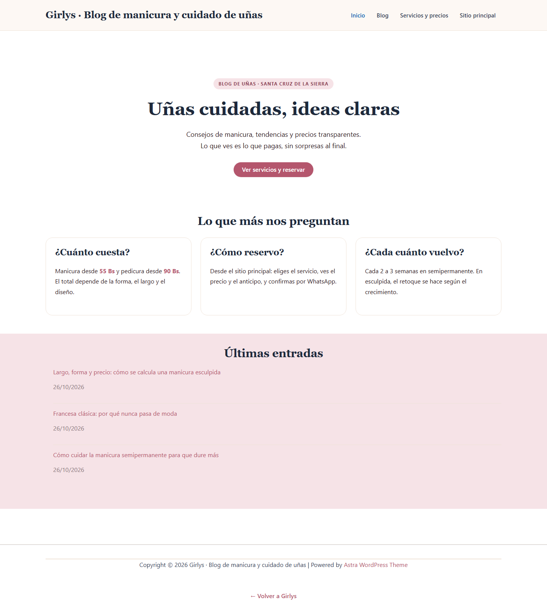

# Punto 7 · Vista inicial del sitio, temática y plugins

## 7.1 Vista del sitio principal

- Paleta crema, rosa y negro: transmite salón de belleza, no una tienda genérica.
- Tipografía serif para los títulos y palo seco para el texto.
- La calculadora y la lista de precios son lo primero que se ve después del hero.
- Botón flotante de WhatsApp siempre visible.

## 7.2 Vista del blog (WordPress)

- Tema **Astra** adaptado con los mismos colores y tipografías del sitio.
- Portada con hero, tres tarjetas de preguntas frecuentes y últimas entradas.
- Menú: Inicio · Blog · Servicios y precios · Sitio principal.
- Pie con enlace de vuelta al sitio comercial.

### Entrada del blog

---

## 7.3 Tema instalado

| Dato | Valor |
|---|---|
| Tema | **Astra** (gratis) |
| Por qué | Liviano, compatible con bloques, muy usado, no requiere licencia |
| Personalización | Plugin *mu* `girlys-estilo.php` con la paleta y tipografía del salón |
| Alternativa incluida | Twenty Twenty-Five (tema por defecto de WordPress) |

El estilo se aplica con un **mu-plugin** (`02-WordPress\wp-content\mu-plugins\girlys-estilo.php`).
Así no se modifica el tema: si se actualiza Astra, los colores siguen igual.

---

## 7.4 Plugins instalados

| Plugin | Estado | Para qué | Configuración |
|---|---|---|---|
| **Rank Math SEO** | Activo | Títulos, sitemap, datos estructurados, redirecciones | Manual (documento 6) |
| **UpdraftPlus** | Activo | Copias de seguridad programadas | Semanal, 4 copias |
| **Wordfence Security** | Activo | Cortafuegos, escaneo de archivos, bloqueo de fuerza bruta | Básica |
| **WP Super Cache** | Guardado | Caché de páginas en el hosting | Activar solo en producción |
| **SQLite Database Integration** | Guardado | Motor de base de datos local | Ya funciona por el *drop-in* |
| **Akismet** | Guardado | Anti-spam de comentarios | No se usa: comentarios cerrados |

### Por qué WP Super Cache está desactivado

La caché guarda HTML estático y **esconde los cambios** mientras se edita.
En local se trabaja sin caché. En el hosting se activa en 30 segundos:
**WP Super Cache → Easy → Caching On**.

### Plugins descartados a propósito

| Plugin | Por qué no |
|---|---|
| Page builders (Elementor, WPBakery) | Pesados; el sitio principal no los necesita |
| WooCommerce | No se venden productos online |
| Revslider | Licencia paga y riesgo de seguridad |
| Plugins de "SEO todo en uno" duplicados | Dos plugins de SEO se estorban |

---

## 7.5 Configuración de WordPress ya aplicada

| Ajuste | Valor |
|---|---|
| Título | Girlys · Blog de manicura y cuidado de uñas |
| Descripción | Consejos de manicura, tendencias y precios claros en Santa Cruz |
| Zona horaria | America/La_Paz |
| Enlaces permanentes | `/%postname%/` → `/blog/mi-entrada/` |
| Comentarios | Cerrados por defecto y en entradas antiguas |
| Visibilidad en buscadores | **Activada** (necesaria para robots.txt y sitemaps) |
| Página de inicio | Página "Inicio" con diseño propio |
| Página de entradas | "Blog" en `/blog/entradas/` |
| Categorías | Cuidado de uñas · Tendencias · Paso a paso |
| Entradas publicadas | 3, con texto real y sin relleno |
| Menú | Inicio · Blog · Servicios y precios · Sitio principal |
| Idioma del panel | Español (es_ES) |

### Sobre la visibilidad en buscadores

Está **activada** (`Ajustes → Lectura → "Disuadir a los motores de búsqueda"` desmarcado).
Es necesario para que WordPress publique `robots.txt` y los sitemaps del blog.
En localhost no hay riesgo de indexación: Google no puede entrar a tu PC.
Al publicar en el dominio real debe quedar igual (activada).

---

## 7.6 Recorrido para la demostración (5 minutos)

1. Abrir `https://localhost:8443/`.
2. Mostrar la calculadora: elegir servicio, forma, largo y diseño → el precio cambia.
3. Pulsar **Reservar** → se abre WhatsApp con el resumen y el anticipo.
4. Bajar a la lista de precios y a las preguntas frecuentes.
5. Abrir `/blog/` y mostrar la portada del blog.
6. Abrir `/blog/wp-admin/` y mostrar:
   - Entradas y categorías.
   - **Apariencia → Temas**: Astra activo.
   - **Plugins**: Rank Math, UpdraftPlus, Wordfence.
   - **Ajustes → Enlaces permanentes**.
7. Volver al sitio y señalar el enlace "Blog" en el pie.

---

## 7.7 Checklist del punto 7

- [x] Sitio principal visible con la temática del salón.
- [x] Blog con el mismo estilo visual.
- [x] Tema instalado y activo (Astra).
- [x] Plugins básicos instalados (SEO, backup, seguridad, caché).
- [x] Contenido inicial publicado (3 entradas, 3 páginas, 3 categorías).
- [x] Menú y portada configurados.
- [x] Comentarios cerrados y buscadores configurados.
- [ ] Activar WP Super Cache al pasar a producción.
- [ ] Revisar los sitemaps del blog al publicar.
