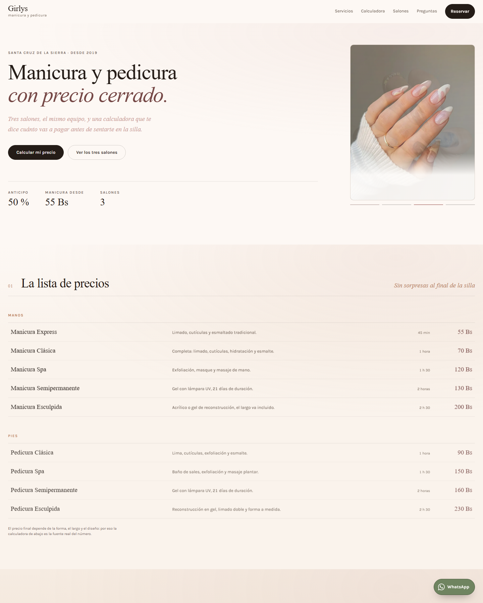
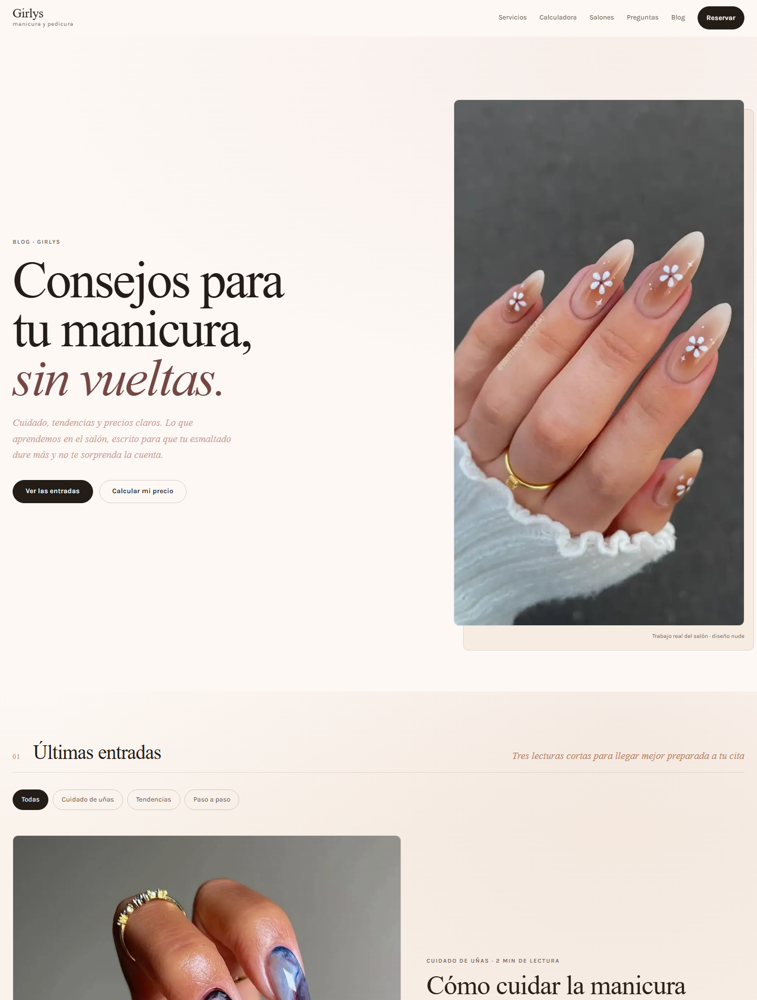
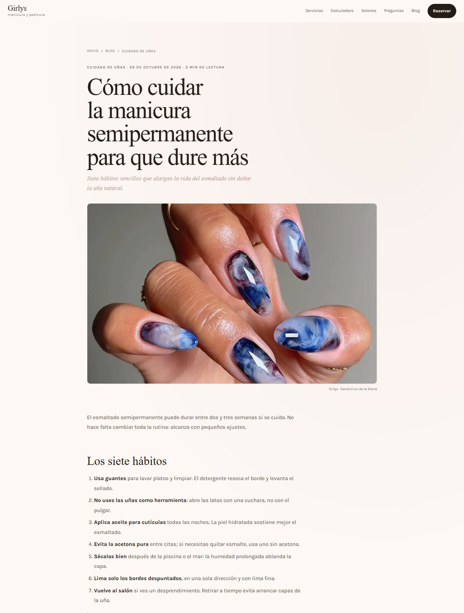

# Punto 7 · Vista inicial del sitio, temática y dependencias

## 7.1 Vista del sitio principal

- Paleta crema, rosa empolvado y negro: transmite salón de belleza, no una tienda genérica.
- Tipografía serif para los títulos y palo seco (Karla) para el texto.
- La calculadora y la lista de precios son lo primero que se ve después de la portada.
- Botón flotante de WhatsApp siempre visible.

## 7.2 Vista del blog

- Mismo sistema visual que el sitio: misma paleta, tipografías y botones.
- Portada con hero, filtros por categoría, una entrada destacada y el resto en tarjetas.
- Menú: Inicio · Servicios · Calculadora · Salones · Preguntas · Blog.
- Pie con enlaces al sitio comercial y aviso de precios.

### Entrada del blog

- Imagen destacada, categoría, fecha y tiempo de lectura.
- Contenido en Markdown renderizado con el mismo estilo del sitio.
- Caja final que invita a calcular el precio y enlaces a entradas relacionadas.

---

## 7.3 Identidad visual implementada

| Dato | Valor |
|---|---|
| Sistema de diseño | Variables CSS en `src/styles/tokens.css` |
| Paleta | Papel crema, rosa empolvado, tinta oscura y bronce |
| Títulos | Serif del sistema (`Times New Roman`) |
| Texto | **Karla**, autoalojada en `public/fuentes` |
| Estilo del blog | `src/styles/blog.css`, con las mismas variables |
| Por qué | Un solo lenguaje visual en todo el sitio; el blog no parece "otra web" |

No se usa una plantilla externa ni un tema comprado: el diseño está escrito
directamente en CSS, así que no hay licencias ni actualizaciones que puedan
romper los colores.

### Cómo se mantiene la coherencia

1. Los colores y espacios salen de `tokens.css`.
2. El sitio y el blog usan las mismas clases base (`btn`, `titular`, `etiqueta`).
3. Si cambia un color en `tokens.css`, cambia en todas las páginas.
4. Las fuentes se sirven desde el mismo dominio: no dependen de Google Fonts.

---

## 7.4 Dependencias del proyecto

En lugar de plugins de WordPress, el sitio usa librerías de JavaScript declaradas
en `01-Sitio-Web/package.json`:

| Dependencia | Versión | Para qué |
|---|---|---|
| **react** | 18 | Interfaz y componentes |
| **react-dom** | 18 | Renderizado en el navegador |
| **react-router-dom** | 6 | Rutas `/`, `/blog` y `/blog/:slug` |
| **marked** | 14 | Convierte las entradas Markdown en HTML |
| **motion** | 14 | Animaciones suaves de la interfaz |
| **vite** | 5 | Construcción y servidor de desarrollo |
| **@vitejs/plugin-react** | 4 | Soporte de React dentro de Vite |

### Por qué no hay plugins de WordPress

El proyecto **no usa WordPress**. Por lo tanto no hay Rank Math, Astra, UpdraftPlus,
Wordfence ni caché de plugins. Cada función que esos plugins resolvían se cubre así:

| Función | Cómo se resuelve |
|---|---|
| SEO y sitemap | `src/lib/seo.js` + `scripts/generar-seo.mjs` |
| Tema y estilos | `tokens.css` y `blog.css` |
| Copias de seguridad | Historial de Git y GitHub |
| Seguridad | Sitio estático: no hay panel ni base de datos que atacar |
| Caché | Vercel sirve los archivos estáticos desde su red |
| Comentarios | Cerrados: no se usan |

### Dependencias descartadas a propósito

| Tecnología | Por qué no |
|---|---|
| WordPress + PHP | Vercel no ejecuta PHP; obligaría a pagar otro hosting |
| MySQL / SQLite | El contenido vive en archivos Markdown versionados |
| Page builders (Elementor, etc.) | Pesados; el diseño ya está hecho en CSS |
| WooCommerce | No se venden productos online |
| Plugins de SEO duplicados | El SEO ya está implementado en el código |

---

## 7.5 Configuración del sitio ya aplicada

| Ajuste | Valor |
|---|---|
| Título del sitio | Girlys · Manicura y pedicura en Santa Cruz de la Sierra |
| Descripción | Calcula el precio, elige forma, largo y diseño, y reserva |
| Idioma | Español (`lang="es"`) |
| Zona horaria de las entradas | Fecha fija en cada archivo Markdown |
| Rutas del blog | `/blog` y `/blog/<nombre-del-archivo>` |
| Categorías | Cuidado de uñas · Tendencias · Paso a paso |
| Entradas publicadas | 3, con texto real y sin relleno |
| Comentarios | No existen |
| Visibilidad en buscadores | `index, follow`; el 404 es `noindex` |
| Analítica | Solo se carga si la persona acepta el aviso |

---

## 7.6 Recorrido para la demostración (5 minutos)

1. Abrir `https://localhost:8443/`.
2. Mostrar la calculadora: elegir servicio, forma, largo y diseño → el precio cambia.
3. Pulsar **Reservar** → se abre WhatsApp con el resumen y el anticipo.
4. Bajar a la lista de precios y a las preguntas frecuentes.
5. Abrir `/blog` y mostrar la portada, los filtros y las tarjetas.
6. Abrir una entrada y señalar la fecha, la categoría y el contenido.
7. Volver al sitio y señalar el enlace **Blog** en el menú y en el pie.
8. Enseñar `01-Sitio-Web/src/content/blog`: las entradas son archivos de texto.

---

## 7.7 Checklist del punto 7

- [x] Sitio principal visible con la temática del salón.
- [x] Blog con el mismo estilo visual.
- [x] Identidad visual definida en un solo archivo de variables.
- [x] Dependencias justificadas y sin plugins innecesarios.
- [x] Contenido inicial publicado (3 entradas, 3 categorías).
- [x] Menú y portada configurados.
- [x] Comentarios cerrados y buscadores configurados.
- [x] Funciona en móvil y en escritorio.
- [x] Sin licencias pagas ni servicios de terceros obligatorios.
